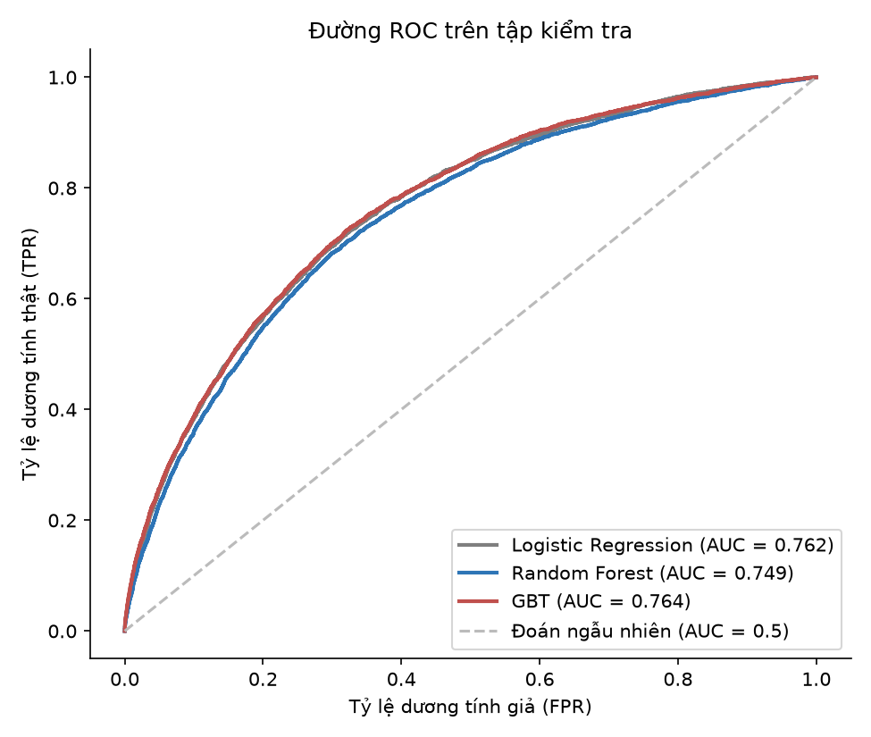
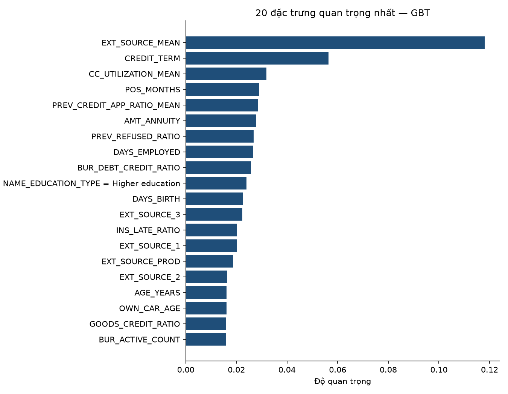
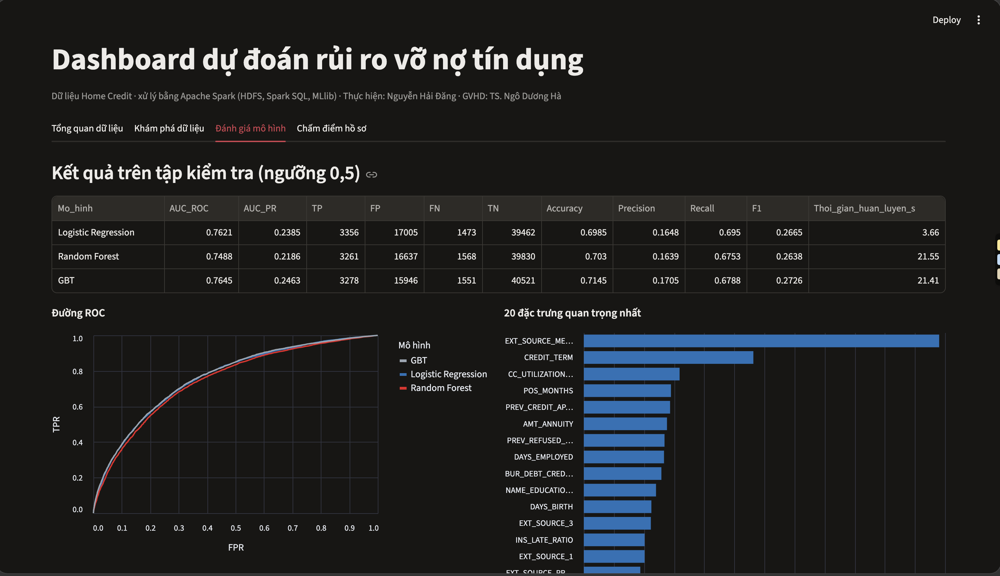
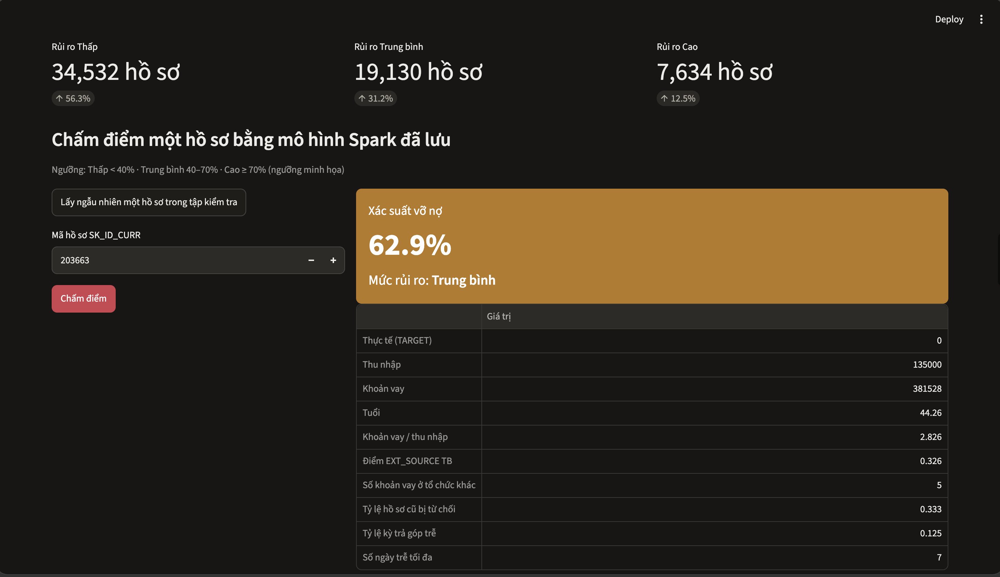

# Dự đoán rủi ro vỡ nợ tín dụng với Apache Spark

Pipeline Big Data dự đoán khả năng một khách hàng gặp khó khăn trả nợ, dùng bộ dữ liệu [Home Credit Default Risk](https://www.kaggle.com/competitions/home-credit-default-risk/data): **2,5 GB, 7 bảng, bảng lớn nhất 27 triệu dòng**. Dữ liệu lưu trên **HDFS**, xử lý bằng **Apache Spark** (Spark SQL, DataFrame, MLlib), kết quả hiển thị trên dashboard **Streamlit**.

Đồ án cá nhân môn Nhập môn Big Data (HUIT).

## Kết quả

<!-- KET_QUA_START -->
**Mô hình tốt nhất: GBT, AUC-ROC 0,7645** trên tập kiểm tra.

| Mô hình | AUC-ROC | AUC-PR | Precision | Recall | F1 | Huấn luyện (giây) |
|---|---|---|---|---|---|---|
| Logistic Regression | 0,7621 | 0,2385 | 0,165 | 0,695 | 0,267 | 3,7 |
| Random Forest | 0,7488 | 0,2186 | 0,164 | 0,675 | 0,264 | 21,6 |
| GBT | 0,7645 | 0,2463 | 0,171 | 0,679 | 0,273 | 21,4 |

Dữ liệu: **58.441.149 dòng** từ 7 bảng; CSV 2.534 MB → Parquet 666 MB (giảm 74%).

| Đọc và tổng hợp bảng installments_payments | Thời gian (giây) |
|---|---|
| pandas + CSV | 1,6 |
| Spark + CSV | 5,0 |
| Spark + Parquet | 0,4 |
<!-- KET_QUA_END -->

| Đường ROC của 3 mô hình | 20 đặc trưng quan trọng nhất |
|---|---|
|  |  |

**Dashboard Streamlit:** chọn ngưỡng duyệt vay để xem Precision/Recall thay đổi, và chấm điểm một hồ sơ bằng mô hình Spark đã lưu.

| Đánh giá mô hình | Chấm điểm hồ sơ |
|---|---|
|  |  |

## Luồng xử lý

```
7 file CSV ──> HDFS ──> Spark: CSV → Parquet ──> Kiểm tra chất lượng (trùng lặp, thiếu, ngoại lệ)
                                   │
                                   ├──> Spark SQL: khám phá dữ liệu
                                   └──> Tổng hợp đặc trưng từ 6 bảng lịch sử → join theo khách hàng
                                              │
                    MLlib Pipeline (StringIndexer, OneHotEncoder, Imputer, VectorAssembler, StandardScaler)
                                              │
                    Logistic Regression · Random Forest · GBT (có trọng số cho lớp thiểu số)
                                              │
                          Lưu mô hình + số liệu ──> Dashboard Streamlit
```

Điểm đáng chú ý:

- **Lưu trữ cột Parquet** thay cho CSV: giảm dung lượng và tăng tốc đọc. Notebook đo và so sánh thời gian pandas với Spark trên cùng tác vụ.
- **Tổng hợp đặc trưng đa bảng:** tỷ lệ trả trễ từ `bureau_balance` (27 triệu dòng), số ngày trễ hạn từ `installments_payments` (13,6 triệu dòng), lịch sử vay trước, thẻ tín dụng; tất cả join về một dòng mỗi khách hàng.
- **Làm sạch:** phát hiện giá trị mã hóa sai (`DAYS_EMPLOYED = 365243`), giới hạn ngoại lệ thu nhập, điền giá trị thiếu bằng `Imputer`.
- **Dữ liệu mất cân bằng** (khoảng 8% vỡ nợ): dùng `weightCol` thay vì bỏ bớt dữ liệu; đánh giá bằng AUC-ROC và AUC-PR thay vì accuracy.

## Công nghệ

| Thành phần | Công nghệ |
|---|---|
| Lưu trữ phân tán | HDFS (Hadoop 3, chế độ một máy), Parquet |
| Xử lý | Apache Spark 3.5: Spark SQL, DataFrame, MLlib (local mode) |
| Mô hình | Logistic Regression (baseline), Random Forest, Gradient-Boosted Trees |
| Trực quan hóa | Jupyter Notebook (matplotlib), Streamlit + Altair |

## Cấu trúc thư mục

```
credit-risk-spark/
├── credit_risk_spark.ipynb   # toàn bộ pipeline Spark (đã lưu kèm kết quả chạy)
├── app.py                    # dashboard Streamlit
├── scripts/
│   ├── hdfs_setup.sh         # cài, chạy HDFS và đưa CSV lên HDFS
│   └── cap_nhat_readme.py    # điền bảng kết quả vào README
├── results/                  # số liệu, hình và dữ liệu dashboard do notebook tạo
├── requirements.txt
└── data/                     # 7 file CSV tải từ Kaggle (không đưa lên GitHub vì 2,5 GB)
```

## Cài đặt và chạy

Các lệnh dưới đây dùng cho macOS (Homebrew). Trên Linux cài Java 17 và Hadoop bằng trình quản lý gói tương ứng.

**1. Java 17**

```bash
brew install openjdk@17
export JAVA_HOME="$(brew --prefix openjdk@17)/libexec/openjdk.jdk/Contents/Home"
```

**2. Môi trường Python và dữ liệu**

```bash
python3.11 -m venv .venv && source .venv/bin/activate
pip install -r requirements.txt
```

Tải 7 file CSV từ Kaggle và giải nén vào `data/`: `application_train`, `bureau`, `bureau_balance`, `previous_application`, `POS_CASH_balance`, `installments_payments`, `credit_card_balance`.

**3. HDFS** (không bắt buộc)

```bash
bash scripts/hdfs_setup.sh      # giao diện HDFS: http://localhost:9870
```

Không cài HDFS thì đặt `STORAGE = "local"` ở ô cấu hình của notebook.

**4. Notebook**

```bash
jupyter notebook credit_risk_spark.ipynb
```

Chạy thử với `SAMPLE_FRACTION = 0.2`; chạy đầy đủ với `1.0` (khoảng 20–40 phút trên MacBook Air M4). Xem tiến trình Spark tại http://localhost:4040.

**5. Dashboard**

```bash
streamlit run app.py
```

### Lỗi thường gặp

| Lỗi | Cách sửa |
|---|---|
| `JAVA_GATEWAY_EXITED` | Chưa đặt `JAVA_HOME` (bước 1) |
| `Connection refused localhost:9000` | HDFS chưa chạy: `hdfs --daemon start namenode && hdfs --daemon start datanode` |
| `OutOfMemoryError` | Giảm `SAMPLE_FRACTION` hoặc đặt `spark.driver.memory` là `6g` |
| GBT chạy quá lâu | Giảm `maxIter` của GBT từ 60 xuống 30 |
| Dashboard báo thiếu `ket_qua.json` | Chạy hết notebook trước |

## Tác giả

**Nguyễn Hải Đăng** – [github.com/haidangbdntbqn-bit](https://github.com/haidangbdntbqn-bit)
